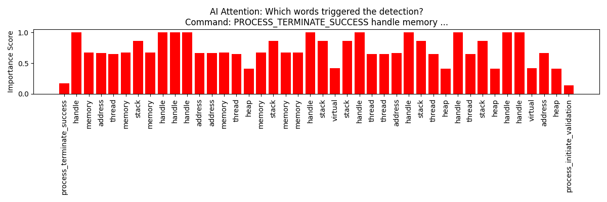

<p align="center">
  <picture><source media="(max-width: 767px)" srcset="assets/readme/banner-m.png"></picture>
</p>

<p align="center">
  
  
  
</p>

Keyword rules catch `mimikatz` in a command line. They miss an event whose words are all ordinary but arrive in an order that cannot happen, such as a process that terminates before it starts. This project trains a small model to catch that. Three CNN filters read short runs of tokens in a Windows Sysmon command line, and a Transformer encoder then looks at the whole line, including the order. `evaluate.py` scores it and draws a saliency map of the tokens that drove each decision.

<p align="center">
  <picture><source media="(max-width: 767px)" srcset="assets/readme/proof-m.png"></picture>
</p>

These numbers come from one training run on a laptop CPU with the data shipped in this repository (4 epochs, a 70/30 split with seed 42). Training starts from random weights, so a rerun moves them slightly.

<p align="center">
  <picture><source media="(max-width: 767px)" srcset="assets/readme/glance-m.png"></picture>
</p>

## Quick start

```powershell
git clone https://github.com/JustKamlesH21/Hybrid_CNN_Sysmon_using_CTI.git
cd Hybrid_CNN_Sysmon_using_CTI
python -m venv .venv; .\.venv\Scripts\Activate
pip install torch numpy scikit-learn matplotlib requests
cd code
copy sysmon_data_*.json data\     # the scripts read from code\data\
python src\train.py               # writes sysmon_model.pth
python src\evaluate.py            # confusion matrix, report, detections, saliency_map.png
```

The `copy` step matters: the shipped datasets sit in `code/`, but every script reads `data/...` relative to where you run it.

## How it works

<p align="center">
  <picture><source media="(max-width: 767px)" srcset="assets/readme/how-it-works-m.png"></picture>
</p>

1. **Collect** (`src/tt_collector.py`, Windows, run as Administrator with Sysmon installed). Reads the `Microsoft-Windows-Sysmon/Operational` log for 5 minutes and tags events with MITRE ATT&CK techniques, downloaded live from [MITRE's CTI repository](https://github.com/mitre/cti).
2. **Generate logic traps** (`src/logic_trap.py`). Writes 500 synthetic command lines. Benign ones read `PROCESS_INITIATE_VALIDATION … PROCESS_TERMINATE_SUCCESS`; malicious ones put the end first. The noise words in between are the same, so only order separates the two classes.
3. **Merge** (`src/data.py`). Real and synthetic samples, shuffled, into `data/sysmon_data_training.json`.
4. **Train** (`src/train.py`). Adam, learning rate 0.001, batch size 8, 4 epochs. Saves the weights and the vocabulary to `sysmon_model.pth`.
5. **Evaluate** (`src/evaluate.py`). Same split, then a confusion matrix, a classification report, every detected line with its confidence, a speed test, and `saliency_map.png`.

### The model

| Layer | Setting (from `src/shared.py`) |
|---|---|
| Tokens | lower-cased words and punctuation, 120 per line max |
| Embedding | 64 dimensions |
| CNN | three parallel `Conv1d` branches, kernel 3, 4 and 5, 32 filters each, ReLU, max-pool |
| Transformer encoder | the 96 concatenated features, 4 heads, 1 layer |
| Output | mean pool, linear, sigmoid: the probability that the line is malicious |

### What the model looks at

<p align="center">
  
</p>

## Architecture

<p align="center">
  <picture><source media="(max-width: 767px)" srcset="assets/readme/architecture-m.png"></picture>
</p>

## Earlier ablation

An earlier comparison against a CNN-only baseline reported higher malicious recall for the hybrid (0.95 against 0.88) and fewer missed attacks (4 against 10). The script and log for that comparison are not in this repository, so it can't be rerun as is. To compare yourself, build `HybridCNNTransformer(vocab, use_transformer=False)` in `train.py` and `evaluate.py`.

## Docker

`code/` has a `Dockerfile` and `docker-compose.yml` with `train` and `evaluate` services. Before `docker-compose build` works, remove the `COPY *.jpg ./` line from the `Dockerfile` (there are no `.jpg` files in `code/`, so that step fails) and copy the JSON files into `code/data/` as above.

## Repository layout

| Path | What it is |
|---|---|
| `code/src/` | Collector, generator, merge, model, training, evaluation |
| `code/sysmon_data_*.json` | Shipped real, synthetic and merged datasets |
| `code/run_project.bat` | A menu for the Docker and data steps |
| `code/v0.1/` | The first collector and dataset |
| `sysmon_model.pth` | A trained model |
| `Hybrid_Architecture.png` | The original architecture drawing |

## License

No license file has been added yet, so default copyright applies.

<p align="center">
  <a href="https://github.com/JustKamlesH21"><picture><source media="(max-width: 767px)" srcset="assets/readme/footer-m.png"></picture></a>
</p>
