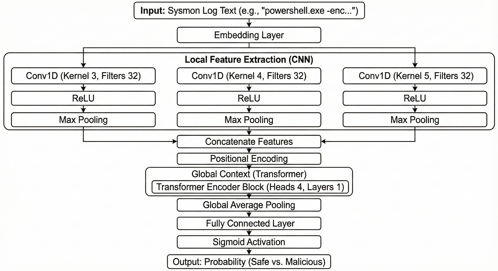

# Hybrid CNN-Transformer for Sysmon Threat Detection

A hybrid CNN + Transformer model for detecting logic-based anomalies in Windows Sysmon logs. This repository contains the data generators, collector, training, and evaluation code plus optional Docker support to run the project reproducibly.

**Contents of this README**
- **Project:** short description and goals.
- **Prerequisites:** software you need installed.
- **Quick Start (PowerShell):** copy-pasteable commands for local runs.
- **Docker:** how to build and run containers with `docker-compose`.
- **Repo Layout:** where to find source files and data.
- **Troubleshooting & Notes.**

**Project Overview**
- **Goal:** Detect malicious or impossible sequences in Sysmon event logs that cannot be detected by simple keyword rules.
- **Approach:** Use a CNN to extract local patterns (n-grams) and a Transformer encoder to model global sequence logic.

**Prerequisites**
- **OS:** Windows 10/11 recommended for running `tt_collector.py` (Sysmon/Windows-only). The rest of the code is cross-platform (Linux/Mac) for training/evaluation.
- **Python:** 3.8 or later.
- **Docker:** Docker Desktop (optional, recommended for reproducible runs).
- **Recommended PowerShell:** Windows PowerShell (v5.1) or PowerShell Core.

**Quick Start — Local (PowerShell)**
1. Open PowerShell and clone the repo:

```powershell
git clone https://github.com/JustKamlesH21/sysmon-hybrid-cnn-transformer.git
cd "Hybrid_CNN_Sysmon_using_CTI"
```

2. Create and activate a virtual environment and install dependencies:

```powershell
python -m venv .venv
.\.venv\Scripts\Activate
pip install --upgrade pip
pip install -r requirements.txt
```

3. (Optional) If you need to collect Sysmon logs from the local Windows host, run the collector as Administrator:

```powershell
# Run from repository root
python .\code\src\tt_collector.py
```

4. Generate synthetic "logic trap" data and prepare datasets:

```powershell
python .\code\src\logic_trap.py
python .\code\src\data.py
```

5. Train the model and save weights (the repo already includes `sysmon_model.pth` as an example):

```powershell
python .\code\src\train.py
```

6. Evaluate and produce saliency maps:

```powershell
python .\code\src\evaluate.py
```

**Quick Start — Docker (recommended)**
This repository contains a `Dockerfile` and `docker-compose.yml` in the `code/` folder to build reproducible containers for training and evaluation.

1. Build the Docker images (run from `code/`):

```powershell
cd .\code
docker-compose build
```

2. Run training inside the container (writes outputs to mounted volumes as configured in `docker-compose.yml`):

```powershell
docker-compose run --rm train
```

3. Run evaluation inside the container:

```powershell
docker-compose run --rm evaluate
```

Notes on Docker volume mounts:
- The `docker-compose.yml` is configured to mount the repository code and `data/` directory into the container. If you want to persist model checkpoints, verify the `volumes:` section in `code/docker-compose.yml` points to a host directory.

**Repository Layout (important files)**
- **`code/`**: contains the Dockerfile, `docker-compose.yml`, and top-level scripts.
- **`code/src/`**: main Python source.
	- `tt_collector.py` — Sysmon log collector (Windows).
	- `logic_trap.py` — synthetic malicious sequence generator.
	- `data.py` — dataset assembly and preprocessing.
	- `train.py` — training loop.
	- `evaluate.py` — evaluation and saliency-map visualization.
	- `shared.py` — shared model/config utilities.
- **`code/data/`** and root-level `data/` — example dataset files (raw & generated).
- **`sysmon_model.pth`** — an example trained model included for convenience.

**How to use `sysmon_model.pth`**
- Place the file in the `code/` or `code/data/` folder (or update `shared.py` to point to its path).
- Use `evaluate.py` to run inference using the checkpoints.

**Troubleshooting & Tips**
- If PowerShell returns an execution policy error when activating the venv, run:

```powershell
Set-ExecutionPolicy -ExecutionPolicy RemoteSigned -Scope CurrentUser;
.\.venv\Scripts\Activate
```

- If Docker commands fail, ensure Docker Desktop is running and that your user has permission to run Docker.
- If training is GPU-accelerated, ensure appropriate CUDA drivers are installed in the host and that the Dockerfile supports GPU (this repo's Dockerfile may require changes to enable GPU).

**Common Commands Summary**
- Activate venv (PowerShell): `.\.venv\Scripts\Activate`
- Install deps: `pip install -r requirements.txt`
- Collect logs: `python .\code\src\tt_collector.py`
- Generate data: `python .\code\src\logic_trap.py` then `python .\code\src\data.py`
- Train: `python .\code\src\train.py`
- Evaluate: `python .\code\src\evaluate.py`
- Docker build: `docker-compose build` (from `code/`)
- Docker run train: `docker-compose run --rm train`

**Contributing & Contact**
- If you make improvements (docs, fixes, additional datasets), please open a pull request.
- For questions, include repository path and a short description of the issue when opening an issue.

**License**
- Distributed under the MIT License. See `LICENSE` for details.

**Architecture & Comparison**

**Model Architecture (high level)**
- Local feature extractor: parallel 1D CNNs (kernel sizes 3, 4, 5) to capture n-gram patterns and keywords (e.g., `powershell -enc`, `System32`, `lsass.exe`).
- Global sequence model: Transformer Encoder with multi-head self-attention to model causality and event ordering across a sequence of Sysmon events.
- Workflow: the CNN encodes local context into embeddings that the Transformer consumes to reason about event order and logical consistency.

**Comparison — CNN-Only (Baseline) vs Hybrid (Proposed)**

| Metric | CNN-Only (Baseline) | Hybrid (Your Model) | Improvement |
|---|---:|---:|---:|
| Accuracy | 96% | 99% | +3% |
| Malicious Recall | 0.88 | 0.95 | +7% (Critical) |
| False Negatives | 10 missed attacks | 4 missed attacks | 60% reduction |
| Precision (Malicious) | 0.97 | 1.00 | Perfect precision |

These metrics summarize the ablation reported in the project: the Hybrid model improves recall for malicious sequences and reduces false negatives substantially while maintaining (or improving) precision.

If you'd like, I can also add the comparison as an image (`comparison_table.png`) into the repo and reference it in this section — tell me if you want me to create and commit that image file.

**Architecture Diagram**



Detailed architecture (diagram notes):
- Input: Sysmon log text (tokenized and embedded by an embedding layer).
- Local Feature Extraction (CNN): three parallel Conv1D branches:
	- Conv1D kernel=3, filters=32 -> ReLU -> MaxPooling
	- Conv1D kernel=4, filters=32 -> ReLU -> MaxPooling
	- Conv1D kernel=5, filters=32 -> ReLU -> MaxPooling
- Concatenate the pooled features and add positional encodings.
- Global Context (Transformer): a Transformer encoder block (example config: 1 layer, 4 heads) that applies multi-head self-attention across the sequence of concatenated features.
- Global Average Pooling over Transformer outputs.
- Fully connected layer followed by a sigmoid activation to produce the final probability (Safe vs Malicious).

Caption: The diagram above shows the end-to-end flow from raw Sysmon text through CNN-based local feature extraction into a Transformer-based global context model that produces a binary probability output.

**Research & Reproducibility**

**Overview**
- **Goal**: Demonstrate that combining local pattern extraction (CNN) with global sequence modeling (Transformer) improves detection of logic-based Sysmon anomalies that keyword rules or CNN-only models miss.
- **Hypothesis**: CNN alone cannot detect sequence-level logic traps (same tokens but invalid ordering); a Transformer captures order/causality and reduces false negatives.

**Datasets & Size**
- **Real data**: collected Sysmon observations from developer machines (background noise). Recommended: at least **10k–50k** event sequences for a baseline experiment.
- **Synthetic data (Logic Trap)**: generated adversarial sequences that preserve token distributions but violate logical ordering. Recommended: similar scale to real data (10k+ sequences) to avoid class imbalance.
- **Storage**: Expect raw JSON logs + processed features ~ **100 MB — 5 GB** depending on retention and feature expansion.

**Experimental Setup & Metrics**
- **Train / Val / Test split**: 70 / 15 / 15 (or use cross-validation for robust estimates).
- **Primary metrics**: **Recall (malicious)**, **Precision (malicious)**, **False Negatives**, **Accuracy**, and **AUC**.
- **Ablation**: compare CNN-only, Transformer-only (optional), and Hybrid models.

**Recommended Hyperparameters (starting point)**
- **Embedding dimension**: 128
- **CNN filters per branch**: 32
- **CNN kernels**: [3,4,5]
- **Transformer**: layers=1, heads=4, hidden_dim=256
- **Batch size**: 64
- **Optimizer**: AdamW, lr=1e-4, weight_decay=1e-5
- **Epochs**: 10–50 (monitor validation recall)
- **Loss**: Binary cross-entropy (optionally with class weights for imbalance)

**Compute & Time Estimates**
- **CPU-only**: feasible for small-scale experiments (<10k sequences) but slow for training; expect many hours to days.
- **GPU (recommended)**:
  - **Small GPU** (e.g., NVIDIA T4 / RTX 2060): training for 10–50k sequences typically completes in **2–8 hours** depending on batch size and epochs.
  - **Mid GPU** (e.g., RTX 3080 / A100): faster (tens of minutes to a few hours).
- **Memory**: 8–16 GB RAM minimum; 16+ GB GPU memory recommended for larger batches and longer sequences.

**Reproducibility Tips**
- **Seed everything**: set seeds for Python, NumPy, and PyTorch in `train.py` and `shared.py`.
- **Use Docker**: the provided `code/Dockerfile` and `code/docker-compose.yml` help freeze environment and package versions.
- **Log experiments**: use `tensorboard` or `wandb` to track metrics and artifacts (checkpoints).
- **Save checkpoints**: keep model weights and training config (`.json`) with each run.

**Expected Results & Interpretation**
- The reported ablation shows **improved malicious recall** (+7%) and **reduced false negatives** (60% reduction) for the Hybrid model compared to CNN-only. This suggests the Transformer component is effective at capturing order-dependent anomalies.


**Reproducing the Experiment (quick checklist)**
1. Prepare dataset: `python .\code\src\data.py` (after collecting/generating inputs).
2. Configure hyperparameters in `code/src/shared.py` or a config file.
3. Train: `python .\code\src\train.py` (or `docker-compose run --rm train`).
4. Evaluate: `python .\code\src\evaluate.py` and compare metrics.

*** End of replacement
